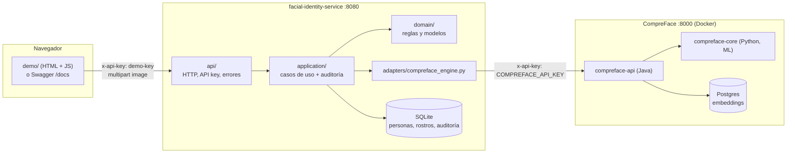
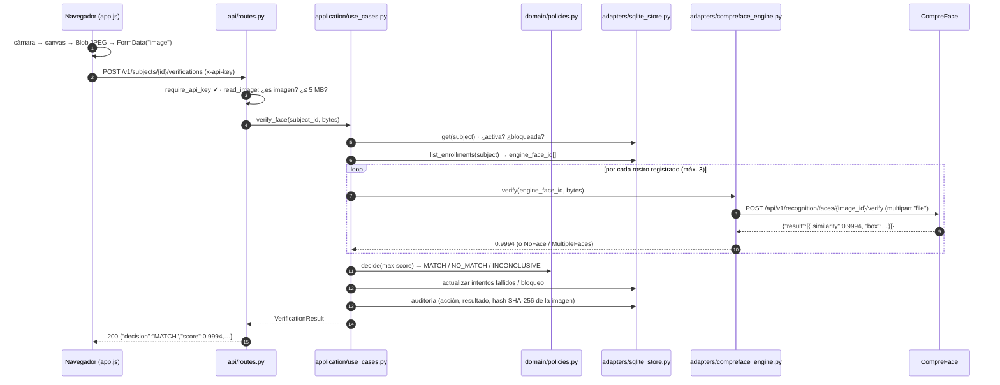

# Cómo funciona por dentro (frontend + backend)

Guía para entender el prototipo a fondo: qué pieza hace qué, cómo viaja una foto desde la cámara hasta la decisión y por qué está construido así. Los enlaces apuntan al código real.

## 1. La foto completa



Hay **tres capas de "quién habla con quién"**:

1. **El consumidor**: la página de demo, Swagger y, mañana, la app móvil o el web administrativo. Solo conoce la API `/v1` del servicio.
2. **El servicio (la fachada)**: aplica las reglas de negocio, audita y traduce todo a un formato propio.
3. **El motor (CompreFace)**: solo sabe detectar rostros, convertirlos en vectores y compararlos. Nunca recibe nombres ni cédulas, solo UUIDs.

## 2. Las dos API keys

Es lo que más confunde al principio:

| Key | Dónde vive | Quién la envía | Para qué |
|---|---|---|---|
| **`FIS_API_KEY`** (por defecto `demo-key`) | `.env` del servicio | El consumidor (demo, Swagger, app) en el header `x-api-key` | Que el **servicio** sepa que el consumidor tiene permiso |
| **`COMPREFACE_API_KEY`** (un UUID) | `.env`; la genera `scripts/bootstrap_compreface.py` | Solo el adaptador [compreface_engine.py](../src/facial_identity/adapters/compreface_engine.py) | Que **CompreFace** acepte las llamadas del servicio |

**En Swagger:** pulsa **Authorize**, escribe `demo-key` y confirma. Swagger la recuerda aunque recargues la página (`persistAuthorization`). Si te devuelve `401 UNAUTHORIZED`, el valor no coincide con `FIS_API_KEY`.

La validación está en [api/auth.py](../src/facial_identity/api/auth.py). Compara con `secrets.compare_digest` para no filtrar información por diferencias de tiempo, y la dependencia se aplica a todo el router `/v1` de una vez ([routes.py](../src/facial_identity/api/routes.py): `APIRouter(prefix="/v1", dependencies=[Depends(require_api_key)])`). `/health` está fuera de ese router, por eso es público.

## 3. ¿Qué es "comparar dos rostros"?

El motor **no compara píxeles**. Para cada foto hace esto:

1. **Detecta** dónde está la cara y con qué confianza. Si la confianza es menor que `COMPREFACE_DET_PROB_THRESHOLD` (0.8), la cara no cuenta.
2. **Alinea y recorta** la cara (ojos y nariz en posición estándar).
3. Pasa el recorte por una red neuronal (con el build Mobilenet, una MobileFaceNet entrenada con ArcFace) que devuelve un **embedding**: un vector de cientos de números que resume los rasgos del rostro. Fotos de la misma persona dan vectores cercanos; personas distintas dan vectores lejanos.
4. **Compara vectores**: la distancia entre dos embeddings se convierte en una **similitud de 0 a 1**, calibrada por modelo.

Por eso:

- **Registrar** = calcular el embedding de la foto y guardarlo (en el Postgres de CompreFace) bajo el UUID de la persona. La foto se descarta (`SAVE_IMAGES_TO_DB=false`).
- **Verificar 1:1** = calcular el embedding de la foto nueva y compararlo con los embeddings de *esa* persona.
- **Identificar 1:N** = compararlo con los de *todas* las personas y quedarse con los más parecidos.
- **No hay entrenamiento**: el modelo ya viene entrenado. Registrar a alguien no cambia el modelo.

Luego **el servicio** convierte la similitud en una decisión de negocio ([domain/policies.py](../src/facial_identity/domain/policies.py), `MatchPolicy`):

```
score ≥ 0.90          → MATCH          (misma persona)
0.80 ≤ score < 0.90   → INCONCLUSIVE   (zona gris: pedir otra foto)
score < 0.80          → NO_MATCH       (otra persona)
```

Los umbrales se configuran en `.env` (`FIS_MATCH_THRESHOLD`, `FIS_INCONCLUSIVE_THRESHOLD`). Esa es justamente la diferencia entre "motor" (da un número) y "servicio" (toma una decisión con reglas).

## 4. Cómo viaja una imagen

### 4.1 El formato: `multipart/form-data`

Las imágenes se envían como **archivo dentro de un formulario**, igual que un `<input type="file">`. No se usa base64 (ocupa ~33% más y no hace falta). Una petición de verificación se ve así en el cable:

```http
POST /v1/subjects/1c0e6a52-…/verifications HTTP/1.1
Host: localhost:8080
x-api-key: demo-key
Content-Type: multipart/form-data; boundary=----XYZ

------XYZ
Content-Disposition: form-data; name="image"; filename="captura.jpg"
Content-Type: image/jpeg

<bytes binarios del JPEG>
------XYZ--
```

El campo **se llama `image`** y es el único del formulario. El `subjectId` va en la URL.

### 4.2 Recorrido paso a paso de una verificación



Qué pasa en cada paso:

1. **Frontend** ([demo/app.js](../demo/app.js)): `capture()` dibuja el fotograma del `<video>` en un `<canvas>` y lo convierte en JPEG con `canvas.toBlob(…, "image/jpeg", 0.9)`. `imageForm()` mete ese Blob en un `FormData` con el nombre `image`, y `api()` lo envía con `fetch` añadiendo el header `x-api-key`. No se fija `Content-Type`: el navegador lo pone solo, con el `boundary`.
2. **API** ([routes.py](../src/facial_identity/api/routes.py)): FastAPI resuelve las dependencias antes de entrar al endpoint:
   - `require_api_key` valida la key.
   - `read_image` recibe el `UploadFile` y valida que sea `image/*`, que no esté vacía y que no pase de 5 MB. Devuelve los `bytes`.
   - `get_service` entrega el servicio de casos de uso.

   El endpoint en sí es una línea: llama al caso de uso y convierte el resultado en el esquema de respuesta.
3. **Caso de uso** ([use_cases.py](../src/facial_identity/application/use_cases.py), `_verify`): busca a la persona, aplica las reglas (inactiva → `SUBJECT_INACTIVE`, bloqueada → `SUBJECT_LOCKED`, sin rostros → `NO_ENROLLMENTS`), pide al motor la similitud contra cada rostro registrado y toma **la mayor**.
4. **Adaptador** ([compreface_engine.py](../src/facial_identity/adapters/compreface_engine.py)): reenvía los bytes a CompreFace como multipart (campo `file`, que es el nombre que CompreFace exige) con su propia API key, y traduce la respuesta:
   - 0 rostros → `NoFaceDetectedError`.
   - 2 o más → `MultipleFacesDetectedError`.
   - Error de conexión → `EngineUnavailableError`.
   - Si todo va bien, devuelve un simple `float`.
5. **Reglas** ([policies.py](../src/facial_identity/domain/policies.py)): `MatchPolicy.decide(score)` da la decisión y `LockoutPolicy` decide si este fallo bloquea a la persona.
6. **Auditoría**: el envoltorio `_audited(...)` registra **siempre**, tanto si sale bien (resultado = decisión) como si sale mal (resultado = `slug` del error). Guarda el SHA-256 de la imagen, nunca la imagen.
7. **Respuesta**: [schemas.py](../src/facial_identity/api/schemas.py) da la forma pública (camelCase). Si en cualquier punto se lanzó un error de dominio, [problems.py](../src/facial_identity/api/problems.py) lo convierte en `application/problem+json`.

### 4.3 Registrar e identificar

- **Registrar** (`_enroll`) sigue el mismo camino, con dos diferencias. Antes de guardar comprueba `EnrollmentPolicy` (máximo de rostros). Y el adaptador primero llama a `/recognize` para **asegurarse de que hay exactamente un rostro**, así no depende de cómo trate CompreFace una foto grupal. Después llama a `POST /recognition/faces?subject=<UUID>`, que devuelve un `image_id`. Ese id se guarda en SQLite (`enrollments.engine_face_id`) y es lo que se usa después para verificar.
- **Identificar** (`_identify`): el adaptador llama a `/recognize?prediction_count=3`. CompreFace devuelve los UUIDs más parecidos y el servicio los traduce a personas, **descarta las inactivas y las que no superan el umbral mínimo**, y ordena el resultado.

## 5. Backend: capas y responsabilidades

```
src/facial_identity/
├── domain/          ← reglas puras: no conoce HTTP, ni SQLite, ni CompreFace
│   ├── models.py      Subject, Enrollment, Decision, ReasonCode, AuditEvent…
│   ├── policies.py    MatchPolicy, EnrollmentPolicy, LockoutPolicy
│   └── errors.py      errores tipados, cada uno con su slug y estado HTTP
├── ports.py         ← contratos: FaceEngine, SubjectRepository, AuditLog, Clock
├── application/
│   └── use_cases.py ← orquesta: reglas + motor + persistencia + auditoría
├── adapters/        ← implementaciones concretas de los puertos
│   ├── compreface_engine.py   motor real (HTTP a CompreFace)
│   ├── fake_engine.py         motor simulado (tests / demostrar el cambio)
│   └── sqlite_store.py        SubjectRepository + AuditLog
├── api/             ← todo lo HTTP
│   ├── routes.py      endpoints (finos: validan entrada y llaman al caso de uso)
│   ├── schemas.py     forma pública de peticiones y respuestas
│   ├── problems.py    errores → problem+json
│   ├── auth.py        x-api-key
│   └── openapi.py     textos de Swagger
├── config.py        ← variables de entorno (.env)
└── main.py          ← "composition root": decide qué adaptadores se conectan
```

**La regla de oro: las dependencias apuntan hacia adentro.**
- `domain` no importa nada del resto.
- `application` depende de `domain` y de los **puertos** (interfaces), nunca de CompreFace.
- Solo [main.py](../src/facial_identity/main.py) (`build_engine`) sabe que existe `CompreFaceEngine`.

Por eso cambiar de motor es escribir una clase nueva que cumpla `FaceEngine` (5 métodos: `enroll`, `verify`, `identify`, `remove_subject`, `is_healthy`) y elegirla con `FIS_ENGINE`. Es la misma idea de Clean Architecture que usa la app Flutter (`domain` ← `infrastructure`).

**Datos que guarda el servicio** (SQLite, archivo `fis-<motor>.db` en el volumen `fis-data`):

| Tabla | Contenido |
|---|---|
| `subjects` | id (UUID), external_id, nombre, estado, intentos fallidos, bloqueado hasta |
| `enrollments` | id, persona, `engine_face_id` (id del rostro en el motor), hash de la foto |
| `audit_events` | acción, fecha, persona, resultado, detalle, hash de la foto |

CompreFace guarda por su lado, en su Postgres, el embedding de cada rostro asociado al UUID.

## 6. Frontend: la página de demo

Son tres archivos estáticos, sin frameworks ni compilación, servidos por el propio servicio en `/demo` ([main.py](../src/facial_identity/main.py), `StaticFiles`):

| Archivo | Rol |
|---|---|
| [index.html](../demo/index.html) | Estructura: panel de captura (izquierda) y pestañas de acciones (derecha) |
| [styles.css](../demo/styles.css) | Estilos con variables CSS y modo oscuro automático |
| [app.js](../demo/app.js) | Toda la lógica |

**Piezas de `app.js`:**

- `state`: guarda la foto actual (`state.image`, un `Blob`) y la lista de personas.
- **Cámara**: `startCamera()` pide permiso con `navigator.mediaDevices.getUserMedia`. Los navegadores solo lo permiten en `localhost` o HTTPS. `capture()` hace canvas → JPEG. El `<video>` se ve en espejo por CSS (`scaleX(-1)`), pero la foto se guarda sin espejar. Subir un archivo (`#file-input`) llega al mismo `setImage()`, así que el resto del flujo no distingue entre cámara y archivo.
- `api(path, options)`: envoltorio de `fetch` que **añade siempre `x-api-key`** (leída del campo de la cabecera) y, si la respuesta no es 2xx, lanza el problem+json para que `showError` lo pinte.
- **Acciones** `enroll`, `verify`, `identify`, `createSubject`, `subjectAction`: cada una arma la petición, la envía y llama a `showResult` con un resumen legible y el JSON completo (desplegable "Respuesta JSON del servicio").
- `run(action)`: ejecuta la acción, captura errores y **refresca personas y auditoría**, para que cada operación se vea al momento en las pestañas *Administrar* y *Auditoría*.
- `loadHealth()`: consulta `/health` (sin key) y pinta el badge "motor: compreface · UP".

**Importante:** la página es solo un **consumidor de ejemplo**. No tiene lógica de negocio. Todo lo que decide (umbrales, bloqueos, inactivos) lo decide el backend. La app Flutter haría exactamente las mismas llamadas.

## 7. Llamar a la API desde otros clientes

**curl** (Git Bash):
```bash
curl -X POST http://localhost:8080/v1/subjects \
  -H "x-api-key: demo-key" -H "Content-Type: application/json" \
  -d '{"externalId":"CUST-1001","displayName":"Ana"}'

curl -X POST http://localhost:8080/v1/subjects/<subjectId>/enrollments \
  -H "x-api-key: demo-key" -F "image=@ana.jpg;type=image/jpeg"

curl -X POST http://localhost:8080/v1/subjects/<subjectId>/verifications \
  -H "x-api-key: demo-key" -F "image=@ana2.jpg;type=image/jpeg"
```
`-F` es lo que genera el `multipart/form-data`. El `type=image/jpeg` importa, porque el servicio rechaza lo que no sea `image/*`.

**PowerShell 7+:**
```powershell
Invoke-RestMethod -Method Post -Uri http://localhost:8080/v1/identifications `
  -Headers @{ "x-api-key" = "demo-key" } -Form @{ image = Get-Item .\foto.jpg }
```

**Python (httpx):**
```python
import httpx
with open("ana2.jpg", "rb") as f:
    r = httpx.post(
        f"http://localhost:8080/v1/subjects/{subject_id}/verifications",
        headers={"x-api-key": "demo-key"},
        files={"image": ("ana2.jpg", f, "image/jpeg")},
    )
print(r.json()["decision"])
```

**Flutter / Dart (así lo haría la app, en `infrastructure`):**
```dart
final request = http.MultipartRequest('POST', Uri.parse('$baseUrl/v1/subjects/$subjectId/verifications'))
  ..headers['x-api-key'] = apiKey
  ..files.add(http.MultipartFile.fromBytes('image', jpegBytes,
      filename: 'selfie.jpg', contentType: MediaType('image', 'jpeg')));
final response = await http.Response.fromStream(await request.send());
```
En producción la app no llamaría directo a este servicio: lo haría a través de su backend, que toma el `customerId` del JWT. Ver [ANALISIS.md](ANALISIS.md#4-integración-con-la-app-móvil-app-mobile-recaudo).

## 8. Errores: cómo leerlos

Todas las respuestas de error tienen la misma forma:

```json
{
  "type": "urn:facial-identity:problem:no_face",
  "title": "No se detectó ningún rostro en la imagen",
  "status": 422,
  "detail": "No se detectó ningún rostro en la imagen",
  "slug": "NO_FACE",
  "instance": "/v1/subjects/…/enrollments"
}
```

El consumidor decide qué hacer **mirando el `slug`**, no el texto. Así, por ejemplo, la app mostraría "acércate a la cámara" ante `NO_FACE`. En Swagger, cada endpoint lista los errores que puede devolver, con un ejemplo de cada uno (sección *Responses*).

| Estado | `slug` | Origen |
|---|---|---|
| 401 | `UNAUTHORIZED` | `api/auth.py` |
| 404 | `SUBJECT_NOT_FOUND` | Caso de uso |
| 409 | `SUBJECT_ALREADY_EXISTS`, `SUBJECT_INACTIVE`, `MAX_ENROLLMENTS`, `NO_ENROLLMENTS` | Reglas de negocio |
| 422 | `VALIDATION_ERROR`, `INVALID_IMAGE`, `NO_FACE`, `MULTIPLE_FACES` | Validación de la petición o de la imagen |
| 423 | `SUBJECT_LOCKED` | `LockoutPolicy` |
| 502 / 503 | `ENGINE_ERROR`, `ENGINE_UNAVAILABLE` | Adaptador del motor |

## 9. Tests

`pytest` usa el **motor simulado** y SQLite en memoria ([tests/conftest.py](../tests/conftest.py)), así que no necesita Docker:

- [test_policies.py](../tests/test_policies.py): umbrales, límite de rostros, bloqueo.
- [test_use_cases.py](../tests/test_use_cases.py): reglas de negocio de punta a punta (inactivos, bloqueo y desbloqueo con un reloj falso, auditoría…).
- [test_api.py](../tests/test_api.py): contrato HTTP (API key, problem+json, forma de las respuestas).

El motor simulado considera "la misma cara" a dos archivos idénticos byte a byte. Con eso basta para probar las reglas sin depender del ML.
